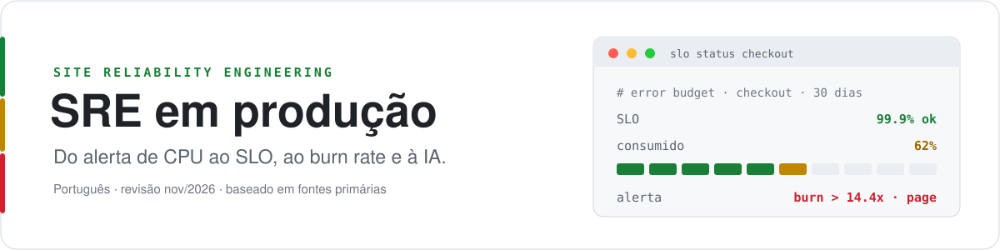
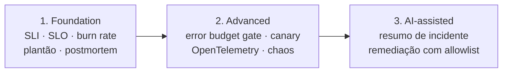

<p align="center">
  <picture>
    <source media="(prefers-color-scheme: dark)" srcset="https://raw.githubusercontent.com/adnazare/sre-guide-ptbr/main/assets/sre-guide-banner.svg">
    
  </picture>
</p>

# SRE em produção: guia prático em português

Guia para quem tem pouco tempo e precisa decidir o que fazer em SRE (Site Reliability Engineering, engenharia de confiabilidade de serviços). As fontes foram reunidas e filtradas, e o que importa está aqui, sem a necessidade de repetir a pesquisa. A ordem segue o que costuma dar mais retorno (SLOs ligados ao usuário, alertas com impacto real, incidentes que geram aprendizado) e só depois chega a ferramentas e IA.

**Edição 2026**, revisada em 3 de novembro de 2026. O guia é atualizado a cada ano, e esta edição inclui IA em SRE: onde ajuda, onde atrapalha e que controles usar.

> [!IMPORTANT]
> Os exemplos e políticas são didáticos. Não são runbooks prontos para produção: adapte e valide cada um à sua arquitetura, ao seu risco e à sua equipe.

## Mapa do guia

| Página | Categorias técnicas | Tipo | Tempo | Leia quando |
| --- | --- | --- | --- | --- |
| [01 · SRE em 2026](docs/01-panorama-sre-2026.md) | Conceito, pesquisa, IA, consolidado × emergente | Contexto | 5 min | Precisa entender o cenário e decidir o que é maduro o bastante para adotar |
| [02 · Práticas essenciais](docs/02-catalogo-praticas.md) | SLI/SLO, observabilidade, incidentes e on-call, toil, release, IA em produção, Platform SRE | Referência | 8 min | Quer saber o que fazer em cada área, com status e esforço |
| [03 · Exemplos](docs/03-exemplos-implementacao.md) | SLO, SLO de agente de IA, recording rules, burn rate, error budget policy, runbook, canary, postmortem | Modelos | 9 min | Vai implementar e quer partir de algo concreto |
| [04 · Anti-padrões](docs/04-antipadroes-e-licoes.md) | Alertas, SLO, entrega, telemetria, incidentes, automação, Kubernetes | Diagnóstico | 7 min | Algo já não funciona e você quer reconhecer o sintoma |
| [05 · Caminho de adoção](docs/05-adocao-caminho-cenarios.md) | Foundation → Advanced → AI-assisted, faixa da IA, 24 meses, cenários | Decisão | 10 min | Precisa planejar ordem, marcos e escopo |
| [06 · Ferramentas](docs/06-ferramentas-2026.md) | Observabilidade, incidentes, agentes de IA, clusters Kubernetes, IaC e segredos, custo, SLO, chaos, operação de sistemas de IA | Comparação | 15 min | Vai avaliar ou renovar ferramentas |
| [07 · Referências](docs/07-referencias.md) | Fontes primárias por tema | Bibliografia | consulta | Quer conferir a origem de uma afirmação |

## Por onde começar

| Você é... | Leia nesta ordem |
| --- | --- |
| Pessoa começando em SRE | [Panorama](docs/01-panorama-sre-2026.md) → [SLI, SLO e error budget](docs/02-catalogo-praticas.md#sli-slo-e-error-budget) → [Exemplos](docs/03-exemplos-implementacao.md) |
| SRE, desenvolvedor ou engenheiro de plataforma | [Práticas essenciais](docs/02-catalogo-praticas.md) → [Exemplos](docs/03-exemplos-implementacao.md) → [Anti-padrões](docs/04-antipadroes-e-licoes.md) |
| Líder ou empresa adotando SRE | [Caminho de adoção](docs/05-adocao-caminho-cenarios.md) → [Como comparar ferramentas](docs/06-ferramentas-2026.md) |
| Equipe que opera ou vai operar IA em produção | [Consolidado × emergente](docs/01-panorama-sre-2026.md#o-que-é-consolidado-e-o-que-ainda-é-emergente) → [Observabilidade](docs/02-catalogo-praticas.md#monitoramento-e-observabilidade) → [Etapa 3: AI-assisted](docs/05-adocao-caminho-cenarios.md#3-ai-assisted-com-apoio-de-ia) |

## Princípios do guia

- **Meça a jornada do usuário, não a máquina.** Um `/healthz` verde não prova que o checkout funciona. A medida (SLI, indicador de nível de serviço) e a meta (SLO, objetivo de nível de serviço) devem refletir o que a pessoa tenta fazer.
- **Página só com impacto e ação.** Alerta de CPU em 80% sem usuário afetado é ticket, não chamada de madrugada.
- **Meta com margem de erro.** Um SLO de 100% não deixa espaço para release nem para falha de zona. O error budget, a margem de falha que o SLO permite, ajuda a decidir entre entregar e estabilizar.
- **IA depois de telemetria e SLO.** IA acelera busca, resumo e rascunho, mas também cria trabalho de revisão. O guia recomenda casos delimitados, evidência rastreável, permissões mínimas, medição do efeito líquido e rollback para qualquer ação automatizada. A responsabilidade pela confiabilidade continua com a organização.

## Etapas de adoção

Cada etapa assume a anterior. Pular para IA sem SLO e telemetria confiáveis tende a aumentar o trabalho de revisão. Os detalhes, com cenários por porte de empresa, estão no [caminho de adoção](docs/05-adocao-caminho-cenarios.md).



<details>
<summary>Ver exemplo: SLO de disponibilidade e alerta de burn rate do checkout</summary>

O SLO é definido pela experiência do usuário:

```yaml
# slo/checkout.yaml
service: checkout
window: 30d
indicators:
  - name: availability
    good: http_requests_total{job="checkout",code!~"5..",handler!="/healthz"}
    valid: http_requests_total{job="checkout",handler!="/healthz"}
    objective: 0.999   # 99,9% em 30 dias → 0,1% de error budget
```

O alerta dispara pela velocidade de consumo do budget (burn rate), não por um limiar fixo:

```yaml
# página quando o budget de 30 dias queima rápido demais
- alert: CheckoutErrorBudgetBurnFast
  expr: |
    job:http_errors:ratio_rate1h{job="checkout"} > (14.4 * 0.001)
    and
    job:http_errors:ratio_rate5m{job="checkout"} > (14.4 * 0.001)
```

O exemplo completo, com latência, recording rules, política de budget, runbook e postmortem, está em [Exemplos de SLO, alertas, runbook e postmortem](docs/03-exemplos-implementacao.md).

</details>

## Sobre as fontes

As páginas citam só o que precisa estar à vista. Fontes completas, em um só lugar, estão em [Referências](docs/07-referencias.md). Status de maturidade, esforço e custo relativo são avaliação editorial do guia, não benchmark de mercado.

## Como contribuir

Correções, melhorias editoriais e referências verificáveis são bem-vindas. Leia o [guia de contribuição](CONTRIBUTING.md), abra uma Issue para problemas ou uma Pull Request para propor mudanças e não inclua credenciais nem dados de clientes.

## Escopo e licença

- Idioma: português brasileiro.
- Base: 16 anos de experiência em engenharia, com foco em plataformas em produção, ambientes regulados e IA.
- Casos de referência vêm de trabalho para clientes confidenciais: aparecem sem nome, sem setor e com valores ilustrativos.
- Dados de mercado e status de produtos refletem a revisão de 3 de novembro de 2026; confirme mudanças na fonte original.
- A licença do conteúdo ainda não foi definida.
