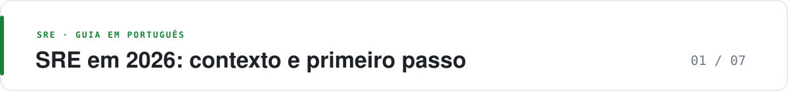

  <picture>
    <source media="(prefers-color-scheme: dark)" srcset="https://raw.githubusercontent.com/adnazare/sre-guide-ptbr/main/assets/banner-01.svg">
    
  </picture>

# SRE em 2026: contexto e primeiro passo

*Para quem está começando em SRE e para quem lidera times · Leitura: cerca de 5 min*

**O essencial**

- SRE trata confiabilidade como parte da engenharia: mede o que o usuário sente, não só se o servidor está de pé.
- Em 2026, a pergunta nova é onde a IA ajuda e onde ela só troca um trabalho por outro (revisão, integração, manutenção).
- Comece por um serviço, uma jornada e uma meta. IA vem depois, em uma tarefa pequena e medida.

## O que é SRE

Site Reliability Engineering (SRE, engenharia de confiabilidade de serviços) não é uma ferramenta nem um time que recebe todos os alertas. É uma forma de construir e operar serviços tratando confiabilidade como parte da engenharia.

A pergunta útil não é “o servidor está ligado?”, mas “a pessoa consegue concluir o que veio fazer?”. Dessa pergunta saem as outras decisões: o que medir, quando chamar alguém e qual melhoria fazer primeiro.

## O que a pesquisa de 2026 mostra

No SRE Report 2026 (418 profissionais de confiabilidade ouvidos em 2025), três números chamam atenção:

- A mediana de toil (trabalho manual, repetitivo e que cresce com o serviço) subiu de 20% para 34%.
- Sobre o efeito da IA no toil, 49% disseram que caiu, 35% que não mudou e 16% que aumentou.
- Só 13% têm muita confiança para monitorar a confiabilidade de IA.

Vale para quem respondeu, não para todo o setor.

### Como ler esses números

IA acelera uma tarefa e, ao mesmo tempo, cria revisão, integração e manutenção. “Adotamos IA” não é medida de ganho. Compare o trabalho inteiro antes e depois: tempo poupado, erros, conferência humana e custo.

Em serviços com IA, uma resposta pode chegar no prazo e mesmo assim não resolver o problema do usuário. Disponibilidade e latência continuam valendo, mas precisam de uma medida de qualidade para a tarefa.

## O que muda na prática

- **Meça uma jornada do usuário**, como login ou pagamento, em vez de só olhar máquinas.
- **Colete só a telemetria que responde a uma pergunta.** Defina retenção e remova dados sensíveis.
- **Escolha ferramenta pela necessidade**, integração, operação, segurança e custo total, não pelo tamanho do catálogo.
- **Separe sugestão de ação** quando usar IA. Verifique a evidência, limite permissões e tenha um jeito de interromper e reverter.
- **Trate provedores e modelos como dependências** do caminho crítico: monitore falhas, limites e alternativas.

## O que é consolidado e o que ainda é emergente

Esta é a classificação do guia, feita para orientar a decisão. Não é dado de adoção de mercado.

| Prática | Status | Em uma frase | Ver |
| --- | --- | --- | --- |
| SLI, SLO e error budget | Consolidado | É a base do resto | [Práticas](02-catalogo-praticas.md#sli-slo-e-error-budget) |
| Alerta por burn rate | Consolidado | Página pelo ritmo de consumo do budget, não por limiar fixo | [Exemplos](03-exemplos-implementacao.md#alerta-por-burn-rate-página-e-ticket) |
| Postmortem sem culpa | Consolidado | Melhora o sistema, não procura culpado | [Incidentes](02-catalogo-praticas.md#incidentes-e-plantão) |
| OpenTelemetry | Consolidado como padrão aberto | Padroniza a instrumentação; o backend continua sendo escolha sua | [Observabilidade](02-catalogo-praticas.md#monitoramento-e-observabilidade) |
| Canary com rollback | Consolidado, com cuidados | Precisa de tráfego suficiente e SLI por versão | [Exemplos](03-exemplos-implementacao.md#canary-com-abort) |
| Chaos em produção | Consolidado como técnica; adoção limitada | Exige hipótese, escopo e abort | [Entrega segura](02-catalogo-praticas.md#entrega-segura-e-testes-de-falha) |
| IA para resumo e rascunho de postmortem | Emergente | Útil como rascunho; uma pessoa confirma | [Etapa 3: AI-assisted](05-adocao-caminho-cenarios.md#3-ai-assisted-com-apoio-de-ia) |
| Agentes de SRE de fornecedores (Datadog, Azure, AWS, PagerDuty) | Emergente, já disponíveis | Lançados entre dezembro de 2025 e novembro de 2026; os ganhos divulgados vêm dos próprios fornecedores | [Agentes de SRE](06-ferramentas-2026.md#agentes-de-sre-lançados-em-2025-e-2026) |
| Remediação automática por agente | Emergente | Só com allowlist, kill switch e teste com o agente desligado | [AIOps](06-ferramentas-2026.md#aiops-e-assistentes) |
| Observabilidade e avaliação de LLM | Emergente | Qualidade medida à parte da disponibilidade | [AIOps](06-ferramentas-2026.md#aiops-e-assistentes) |
| Convenções OpenTelemetry para GenAI | Emergente | Ainda mudam; confira antes de adotar | [Referências](07-referencias.md) |

## De onde vêm as práticas

O guia não inventa método: organiza e filtra o que organizações de referência publicaram. Os links estão em [Referências](07-referencias.md).

| Origem | O que o guia usa |
| --- | --- |
| Google (SRE Book e Workbook) | SLI, SLO, error budget, alerta por burn rate, incidentes, postmortem e plantão |
| Netflix e a comunidade de chaos engineering | Experimentos de falha com hipótese e escopo controlado |
| AWS e Azure (pilar de confiabilidade do Well-Architected) | Critérios de projeto para resiliência, recuperação e mudança |
| CNCF e OpenTelemetry | Instrumentação aberta e o ecossistema de Kubernetes |

## Sete cuidados que a IA traz de volta

Quando o código passa a ser gerado em volume e agentes ganham acesso à infraestrutura, fundamentos antigos voltam a pesar. Esta lista alimenta os critérios das páginas seguintes.

| Cuidado | Por que importa |
| --- | --- |
| Medir entrega e estabilidade juntas (métricas DORA) | Gerar mais código não prova que a entrega melhorou |
| Confiança zero | Privilégio mínimo e credencial temporária, também para pipelines e agentes |
| Isolar o agente | Execução em sandbox limita o que ele consegue alcançar |
| Simulador com estado para testar a detecção | Mostra se métrica, alerta e dashboard reagem à falha antes do incidente real |
| Fluxo de agente que sobrevive a falhas | O que não retoma depois de uma queda só funciona na demonstração |
| Automação criada fora da engenharia | Precisa de um caminho seguro até a produção, com dono e alerta |
| Volume de código não é produtividade | A métrica certa olha fluxo e estabilidade, não linhas nem deploys |

## Um primeiro passo

1. **Escolha um serviço e uma jornada** que importem para o usuário.
2. **Defina o que é sucesso** com uma medida simples de disponibilidade e, se precisar, de latência. Combine a meta com produto.
3. **Alerte pelo impacto**, com uma ação clara para quem está de plantão e um runbook curto.
4. **Aprenda com falhas e trabalho repetido.** Corrija causas recorrentes antes de comprar ferramenta ou automatizar tudo.
5. **Teste IA numa tarefa limitada.** Só avance se o ganho continuar depois de contar revisão, erros e custo.

Para implementar, siga as [práticas essenciais](02-catalogo-praticas.md). Para planejar a adoção, veja o [caminho de adoção](05-adocao-caminho-cenarios.md). As fontes ficam em [Referências](07-referencias.md).

---

[Índice do guia](../README.md#mapa-do-guia) · [Próxima: Práticas essenciais →](02-catalogo-praticas.md)
