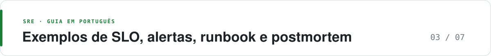

<p align="center">
  <picture>
    <source media="(prefers-color-scheme: dark)" srcset="https://raw.githubusercontent.com/adnazare/sre-guide-ptbr/main/assets/banner-03.svg">
    
  </picture>
</p>

# Exemplos de SLO, alertas, runbook e postmortem

*Para quem: quem vai implementar · Leitura: cerca de 9 min*

**O essencial**

- Todos os modelos usam um serviço fictício, `checkout`, com SLO de 99,9% em 30 dias.
- A página sai do burn rate em duas janelas; o que queima devagar vira ticket.
- Ajuste meta, rota e limiares só depois de medir o SLI por algumas semanas.

Modelos mínimos para as práticas descritas em [Práticas essenciais](02-catalogo-praticas.md). Ajuste nome de serviço, rota e meta. Não copie a meta de 99,9% sem medir o SLI (indicador de nível de serviço) por algumas semanas.

Os exemplos de SLO e burn rate seguem o método do Google SRE Workbook (veja as [referências](07-referencias.md)). YAML e URLs internos são ilustrativos e precisam ser adaptados e validados para cada ambiente. O serviço `checkout`, as datas e os números do postmortem são fictícios. Os blocos longos estão recolhidos: clique no título para expandir.

Convenções usadas aqui:

- Janela do SLO (objetivo de nível de serviço): 30 dias.
- Meta de disponibilidade: 99,9% das requisições válidas de `checkout`.
- Budget: 0,1% (`0.001`).
- Evento válido: requisição com `job="checkout"`, excluindo o probe `handler="/healthz"`.
- Evento ruim: HTTP 5xx, ou latência acima do limiar no SLO de latência (SLO separado).

## SLI e SLO em YAML

<details>
<summary>Ver o YAML completo do SLI e do SLO do checkout (disponibilidade e latência)</summary>

```yaml
# slo/checkout.yaml
service: checkout
owner: payments-team
window: 30d
indicators:
  - name: availability
    description: >
      Proporção de requisições HTTP válidas de checkout que retornam
      status menor que 500.
    good: http_requests_total{job="checkout",code!~"5..",handler!="/healthz"}
    valid: http_requests_total{job="checkout",handler!="/healthz"}
    objective: 0.999
  - name: latency
    description: >
      Proporção de requisições válidas atendidas em menos de 300 ms.
    good: >
      http_request_duration_seconds_bucket{
        job="checkout",handler!="/healthz",le="0.3"
      }
    valid: >
      http_request_duration_seconds_count{
        job="checkout",handler!="/healthz"
      }
    objective: 0.99
exclusions:
  - tráfego com header X-Load-Test=true
  - rota /healthz
policy: policies/error-budget.md
```

</details>

Disponibilidade e latência não se fundem num único número. Um mês pode cumprir um e estourar o outro.

Tradução do budget de disponibilidade, para conversa com produto:

| Meta | Eventos ruins admitidos em 1.000.000 | Leitura aproximada em tempo, se o tráfego for contínuo |
| --- | --- | --- |
| 99,9% | 1.000 | cerca de 43 minutos em 30 dias |
| 99,95% | 500 | cerca de 22 minutos |
| 99,99% | 100 | cerca de 4,3 minutos; Google trata orçamento desse tamanho em janela trimestral |

A coluna de tempo só vale se a falha for contínua. Uma rajada de 1.000 erros em um minuto queima o mesmo budget de disponibilidade de 99,9% que 43 minutos de outage total, se o volume do mês for 1.000.000.

## Recording rules de erro por janela

<details>
<summary>Ver as recording rules de taxa e razão de erros</summary>

```yaml
groups:
  - name: checkout-slo
    interval: 30s
    rules:
      - record: job:http_requests:rate5m
        expr: |
          sum by (job) (
            rate(http_requests_total{job="checkout",handler!="/healthz"}[5m])
          )
      - record: job:http_errors:rate5m
        expr: |
          sum by (job) (
            rate(http_requests_total{job="checkout",handler!="/healthz",code=~"5.."}[5m])
          )
      - record: job:http_errors:ratio_rate5m
        expr: |
          job:http_errors:rate5m{job="checkout"}
          /
          job:http_requests:rate5m{job="checkout"}
```

</details>

Repita o par de regras e a razão para as janelas 30m, 1h, 6h e 3d, nomeando-as `job:http_errors:ratio_rate30m`, `ratio_rate1h`, `ratio_rate6h` e `ratio_rate3d`: são os nomes usados nos alertas abaixo. Uma recording rule (regra do Prometheus que pré-calcula uma consulta) por janela evita avaliar o mesmo `rate()` várias vezes na regra de alerta.

## Alerta por burn rate: página e ticket

Burn rate é a velocidade com que o serviço consome o error budget. Parâmetros do Workbook para SLO de 99,9% em 30 dias:

| Severidade | Janela longa | Janela curta | Burn rate | Budget consumido na janela longa |
| --- | --- | --- | --- | --- |
| Página | 1 h | 5 min | 14,4 | 2% |
| Página | 6 h | 30 min | 6 | 5% |
| Ticket | 3 d | 6 h | 1 | 10% |

`14,4 × 0,001 = 0,0144`. A janela curta precisa concordar, senão o alerta continua depois que o erro parou, ou dispara num pico de um scrape.

<details>
<summary>Ver as regras de alerta de burn rate (página e ticket)</summary>

```yaml
groups:
  - name: checkout-slo-alerts
    rules:
      - alert: CheckoutErrorBudgetBurnFast
        expr: |
          (
            job:http_errors:ratio_rate1h{job="checkout"} > (14.4 * 0.001)
            and
            job:http_errors:ratio_rate5m{job="checkout"} > (14.4 * 0.001)
          )
          or
          (
            job:http_errors:ratio_rate6h{job="checkout"} > (6 * 0.001)
            and
            job:http_errors:ratio_rate30m{job="checkout"} > (6 * 0.001)
          )
        labels:
          severity: page
          service: checkout
          slo: availability
        annotations:
          summary: Checkout queima error budget de disponibilidade rápido demais
          description: >
            Burn rate acima de 14,4x por 1h (confirmado em 5m)
            ou acima de 6x por 6h (confirmado em 30m).
            SLO 99,9% em 30 dias.
          runbook: https://runbooks.internal/checkout/error-budget-burn

      - alert: CheckoutErrorBudgetBurnSlow
        expr: |
          job:http_errors:ratio_rate3d{job="checkout"} > (1 * 0.001)
          and
          job:http_errors:ratio_rate6h{job="checkout"} > (1 * 0.001)
        labels:
          severity: ticket
          service: checkout
          slo: availability
        annotations:
          summary: Checkout consome error budget de forma lenta
          runbook: https://runbooks.internal/checkout/error-budget-burn
```

</details>

Roteamento: `severity=page` vai para o plantão. `severity=ticket` abre issue e não toca o telefone.

Para 99,99% não reuse 14,4 e 6 sem recalcular a tabela do Workbook. O tempo até detectar e a fração do budget mudam.

## Política de error budget

<details>
<summary>Ver o modelo de política de error budget do checkout</summary>

```markdown
# Política de error budget — checkout

Janela: 30 dias, móvel.
SLO: disponibilidade 99,9%; latência 99% < 300 ms.

## Estados

- Verde: mais de 50% do budget restante nos dois SLOs. Release normal.
- Amarelo: entre 20% e 50%. Review na reunião semanal. Canary obrigatório.
- Vermelho: menos de 20%, ou budget esgotado. Para release não urgente.

## Exceções que seguem em vermelho

- Correção do defeito que está consumindo o budget.
- Correção de vulnerabilidade explorável, com risco aceito pelo security owner.

## Quem decide

- Amarelo: tech lead de payments.
- Vermelho: tech lead e o SRE de plantão da plataforma. Empate favorece parar a feature.

## Saída do vermelho

Budget de volta acima de 20% na janela móvel, ou ação do postmortem que remove a causa já em produção e a queima estabilizada por 48 h.
```

</details>

Chaos autorizado consome budget. A política deve dizer se o experimento entra numa exclusão temporária ou se o time aceita o gasto. Exclusão silenciosa é SLO shopping.

## Runbook de uma página

Uma página. Se precisar de romance, o alerta está errado.

<details>
<summary>Ver o modelo de runbook de uma página para o alerta de burn rate</summary>

```markdown
# Checkout — queima rápida de error budget

## O que esta página significa

O checkout está produzindo erro 5xx suficiente para ameaçar o SLO de 99,9%
antes do fim da janela. Não é alerta de CPU.

## Impacto

Usuário no pagamento recebe falha. Severidade inicial: SEV-2 se a queima
for a de 6h; SEV-1 se a de 1h coincidir com queda clara de conversão.

## Olhar nesta ordem

1. Painel RED de checkout, comparado à versão em canary e à versão estável.
2. Mudança de deploy nos últimos 60 minutos. Se o canary desviou, rodar rollback.
3. Trace de um 5xx (exemplar do histograma). Dependência usual: ledger e vault.
4. Sintético externo: se o de dentro falha e o de fora não, o problema pode ser scrape ou rótulo.

## Ações seguras sem esperar mais ninguém

- Rollback do Deployment checkout para a revisão anterior, se o canary está pior.
- Abrir incidente na ferramenta, severidade conforme a tabela, avisar o canal #checkout.

## Não fazer

- Reiniciar todos os pods em loop.
- Aumentar réplica se a dependência está no limite: isso aumenta a carga nela.
- Silenciar por mais de 2 h sem dono.

## Escalar

- 15 min sem hipótese: chamar o secundário.
- Ledger ou vault no trace: paginar o plantão desse serviço, não debugar o banco deles no escuro.
```

</details>

## Canary com abort

Forma conceitual, no vocabulário de um controller de rollout. Os campos variam entre Argo Rollouts, Flagger e o serviço do cloud provider.

<details>
<summary>Ver o exemplo conceitual de canary com abort e rollback automático</summary>

```yaml
strategy:
  canary:
    steps:
      - setWeight: 5
      - pause: { duration: 15m }
      - setWeight: 25
      - pause: { duration: 15m }
      - setWeight: 100
    analysis:
      metrics:
        - name: error-ratio
          interval: 1m
          successCondition: result < 0.001
          failureLimit: 2
          query: |
            sum(rate(http_requests_total{job="checkout",version="canary",code=~"5.."}[5m]))
            /
            sum(rate(http_requests_total{job="checkout",version="canary"}[5m]))
    rollback: automatic
```

</details>

O limiar `0.001` aqui é o erro admissível do SLO, não o burn rate de página. Canary compara contra a baseline estável quando o tráfego do canary é pequeno demais para a razão ser estável. Com poucas requisições, duas falhas disparam falso rollback. Exija um mínimo de pedidos na janela antes de avaliar.

## SLO de um agente de IA: latência com e sem cache

Exemplo de SLO para IA. Os valores são ilustrativos, inspirados em agentes de um cliente confidencial, e precisam ser medidos no seu sistema antes de virar meta.

<details>
<summary>Ver o YAML do SLO de latência e de qualidade de um agente (formato ilustrativo)</summary>

```yaml
# slo/assistente-ia.yaml
service: assistente-ia
window: 30d
segment_by: [tenant, model]
indicators:
  - name: latency_cache_hit
    description: Respostas servidas do cache, p95 abaixo de 900 ms.
    threshold: 900ms
    objective: 0.95
  - name: latency_cache_miss
    description: Respostas geradas pelo modelo, p95 abaixo de 2,5 s.
    threshold: 2500ms
    objective: 0.95
  - name: grounded_answer
    description: >
      Proporção de respostas com fonte citada, medida por avaliação
      numa amostra diária (não em todas as respostas).
    objective: 0.90
alerts:
  - name: custo_por_tenant
    description: Gasto de modelo do tenant acima do orçamento diário.
policy: policies/error-budget.md
```

</details>

Por que dois SLOs de latência: com 80% de cache, a média parece ótima mesmo quando o caminho do modelo está estourando. Separar mostra o problema e diz onde agir: aquecer o cache, trocar de modelo ou limitar o contexto. O orçamento de erro de `grounded_answer` entra na política de budget como qualquer outro.

## Modelo de postmortem

<details>
<summary>Ver o modelo de postmortem (exemplo fictício de um SEV-1)</summary>

```markdown
# Postmortem — checkout SEV-1 — 2026-10-12

Status: revisado
Severidade: SEV-1
Duração do impacto: 10:14–10:41 UTC
Impacto: 18% das tentativas de pagamento falharam; 6,2% do error budget do mês
Detecção: alerta CheckoutErrorBudgetBurnFast, 4 minutos após o início

## Resumo

A versão 2026.10.12.3 passou no canary de 5% porque o bug só aparecia
quando o ledger respondia acima de 800 ms. A promoção para 100% coincidiu
com a saturação do pool do ledger.

## Linha do tempo

- 10:02 deploy promovido a 100%
- 10:10 latência do ledger sobe
- 10:14 erro 5xx no checkout atravessa 1%
- 10:18 página
- 10:27 rollback concluído
- 10:41 SLI de volta ao patamar anterior

## Causas contribuintes

- O canary não tinha tráfego bastante, nem injeção de latência, para ver o timeout novo de 200 ms.
- O timeout foi reduzido no mesmo release em que o pool do ledger já operava com fila.
- O alerta de saturação do ledger era ticket e ninguém olhou na janela do lançamento.

## O que funcionou

- Rollback por botão único, em um passo.
- Página de burn rate, sem depender de alguém notar o gráfico.

## Ações

| Ação | Dono | Prazo |
| --- | --- | --- |
| Análise de canary compara p95 com a baseline e aborta | payments | 2026-10-26 |
| Timeout e pool do ledger revisados juntos, com teste de carga | ledger | 2026-11-09 |
| Ticket de saturação do ledger visível no checklist de release do checkout | platform | 2026-10-20 |

## O que não será feito

- Culpar quem reduziu o timeout. O sistema aceitou as duas mudanças no mesmo dia.
```

</details>

Se um assistente preencher a linha do tempo, cada horário precisa apontar para o evento de deploy, o alerta ou a mensagem. Frase sem fonte sai do texto.

## O que não transformar em página

```yaml
# Anti-exemplo: não acorde ninguém com isto
- alert: HighCPU
  expr: instance:node_cpu_utilisation:ratio > 0.8
```

CPU alta sem fila e sem queima de SLO é ticket de capacidade, ou nem isso. O mesmo vale para disco em 80% com projeção de 40 dias, e para restart isolado de pod que o Deployment recriou.

---

[← Anterior: Práticas essenciais](02-catalogo-praticas.md) · [Índice do guia](../README.md#mapa-do-guia) · [Próxima: Anti-padrões →](04-antipadroes-e-licoes.md)
