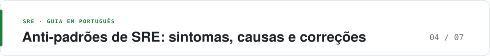

  <picture>
    <source media="(prefers-color-scheme: dark)" srcset="https://raw.githubusercontent.com/adnazare/sre-guide-ptbr/main/assets/banner-04.svg">
    
  </picture>

# Anti-padrões de SRE: sintomas, causas e correções

*Para quem: SRE, desenvolvimento e líderes de equipes com plantão difícil · Leitura: cerca de 7 min*

**O essencial**

- Quase todo anti-padrão nasce de medir o que é fácil, não o que o usuário sente.
- Comece limpando páginas sem ação. Ferramenta nova vem depois.
- Plantão já ruim? Vá direto para a [ordem de ataque](#ordem-de-ataque-se-o-plantão-já-está-ruim).

Anti-padrão é uma prática comum que parece razoável, mas costuma gerar incidente, custo ou desgaste da equipe. Cada item abaixo traz o sintoma visível, a causa provável e a correção que este guia recomenda. A correção aponta para uma prática, não para uma ferramenta nova.

Para aprofundar os princípios, veja as [práticas essenciais](02-catalogo-praticas.md).

## Alertas e plantão

- **Over-paging.** *Sintoma:* mais de duas páginas por turno, a maioria sem ação. *Causa:* todo gráfico ganhou alerta de telefone. *Correção:* página só com impacto ao usuário e ação humana; o resto vira ticket.
- **Alert fatigue.** *Sintoma:* reconhecimento em segundos e nenhuma ação. *Causa:* o plantão aprendeu que o telefone mente. *Correção:* apagar ou rebaixar o que ficou sem ação por 90 dias e medir a precisão da página.
- **Limiar de recurso tratado como SLO.** *Sintoma:* página de CPU em 80% com o usuário intacto. *Causa:* monitorar o que é fácil de coletar. *Correção:* RED e burn rate para página; USE para capacidade, em ticket.
- **Herói de plantão.** *Sintoma:* uma pessoa recebe todas as páginas. *Causa:* escala inexistente ou alerta sujo. *Correção:* limpar as páginas primeiro; depois escala, sombra e compensação.
- **Follow-the-sun de fachada.** *Sintoma:* o outro fuso só “acompanha” e não pode alterar nada. *Causa:* ferramenta de escala sem mandato. *Correção:* handoff com autoridade de rollback e runbook utilizável por esse time.
- **Ops como service desk.** *Sintoma:* SRE passa o mês atendendo pedidos de acesso e restart. *Causa:* toil sem teto. *Correção:* meta de toil, self-service e não prometer cobertura humana infinita.

## SLO e error budget

- **SLO shopping.** *Sintoma:* a meta muda toda vez que o gráfico fica vermelho. *Causa:* a meta foi escolhida para ficar verde. *Correção:* meta estável por um trimestre; mudança só com o dono de produto e com o motivo escrito.
- **SLO de 100%.** *Sintoma:* qualquer erro vira incidente político. *Causa:* confundir desejo com orçamento. *Correção:* budget explícito; 100% não deixa espaço para release nem para falha de zona.
- **SLI de health check.** *Sintoma:* `/healthz` verde e o checkout quebrado. *Causa:* a sonda não percorre a jornada. *Correção:* SLI na rota do usuário; health check fica para o kubelet.
- **Um SLO para latência e erro.** *Sintoma:* o número esconde qual dos dois quebrou. *Causa:* vontade de um único semáforo. *Correção:* dois SLOs; a pior queima define a página.
- **Error budget decorativo.** *Sintoma:* dashboard de budget sem freeze. *Causa:* produto nunca aceitou a consequência. *Correção:* política com estado vermelho e com o nome de quem decide.
- **Freeze sem exceção de segurança.** *Sintoma:* vulnerabilidade espera o mês virar. *Causa:* a política só fala de feature. *Correção:* exceção escrita para correção de segurança e para a causa do estouro.

## Entrega e mudança

- **Canary cego.** *Sintoma:* promoção com cinco pedidos e zero erro. *Causa:* a fatia não tinha tráfego. *Correção:* volume mínimo, comparação com a baseline e teste de latência da dependência.
- **Rollback que não reverte dado.** *Sintoma:* o deploy voltou e o schema não. *Causa:* padrão expand-contract ignorado. *Correção:* migração compatível com a versão anterior antes do canary.
- **Feature flag órfã.** *Sintoma:* caminho morto e incidente em código “desligado”. *Causa:* flag sem dono nem data. *Correção:* dono, expiração e remoção no prazo.

## Telemetria e custo

- **Cardinalidade aberta.** *Sintoma:* fatura alta ou OOM (falta de memória) do Prometheus depois de um release. *Causa:* `user_id`, URL completa ou trace id em rótulo de métrica. *Correção:* teto no collector e métrica agregada; identificador de alta cardinalidade só no trace ou no log.
- **Sampling uniforme.** *Sintoma:* o incidente de 0,2% não tem trace. *Causa:* amostra cega. *Correção:* manter os erros e amostrar os sucessos.
- **Dois backends sem papel definido.** *Sintoma:* números de latência que não batem. *Causa:* medo de desligar o agent antigo. *Correção:* um período de sombra, uma SLI de referência e desligar o duplicado.
- **PII no span.** *Sintoma:* documento de cliente no atributo e no SaaS. *Causa:* a auto-instrumentação grava header e body. *Correção:* processor que remove o dado e revisão de atributo antes de ligar o exporter.
- **Observability antes da pergunta.** *Sintoma:* três produtos de APM e nenhum SLO. *Causa:* compra no lugar de definição. *Correção:* uma jornada, uma SLI, um backend e OpenTelemetry na saída.

## Incidentes e aprendizado

- **Postmortem de culpado.** *Sintoma:* a ação é “fulano vai ter mais cuidado”. *Causa:* a organização quer um nome. *Correção:* causas no sistema; ação com dono e data, sobre código ou processo.
- **Causa raiz única.** *Sintoma:* o relato para na primeira história plausível. *Causa:* pressa de fechar. *Correção:* várias causas contribuintes; a linha do tempo manda, não a teoria.
- **Produtividade medida por volume de código.** *Sintoma:* o volume de código e de deploys sobe, e ninguém olha a estabilidade. *Causa:* a IA acelera a produção de código e a métrica olha só a velocidade. *Correção:* acompanhar fluxo de entrega e estabilidade juntos (métricas DORA) e conferir se a aceleração melhora a entrega de verdade.
- **MTTR como troféu.** *Sintoma:* o tempo médio de recuperação cai porque ninguém declara incidente pequeno, ou porque se fecha cedo. *Causa:* métrica única de bônus. *Correção:* SLO, recorrência e percentual de ações de postmortem fechadas.
- **Chaos sem hipótese.** *Sintoma:* “vamos derrubar coisa e ver”. *Causa:* a ferramenta comprou a prática. *Correção:* uma frase do tipo “se a zona A cair, o SLO se mantém”, com abort ligado.
- **Chaos só em staging.** *Sintoma:* o exercício passa e a produção quebra no failover real. *Causa:* staging não tem o terceiro nem o dado. *Correção:* produção em horário comercial, com escopo escrito, depois de um exercício em staging para ensaiar o facilitador.
- **Game day com o agente ligado.** *Sintoma:* a automação esconde a falha e o time não pratica. *Causa:* querer mostrar que a IA funciona. *Correção:* um exercício com remediação automática desligada e outro, com hipótese separada, com ela ligada.

## Automação e IA

- **Workflow de agente sem durabilidade.** *Sintoma:* funciona na demonstração e falha em produção; uma queda de rede ou de servidor derruba a tarefa inteira e refaz o custo. *Causa:* tratar chamadas de LLM e de ferramentas como se nunca falhassem. *Correção:* persistir o progresso e as chamadas de ferramenta, permitir retomada e pausa para aprovação humana; comece pelo suporte do próprio framework e use uma plataforma de execução durável (como Temporal ou Restate) quando o fluxo for crítico.
- **Shadow IT acelerada por IA.** *Sintoma:* um processo de negócio importante roda em automação criada fora da engenharia, sem dono, alerta ou registro de uso. *Causa:* ferramentas de IA tornam fácil criar fluxos sem passar por engenharia. *Correção:* oferecer um caminho seguro entre experimentar e operar, com ambiente controlado, instrumentação e catálogo compartilhado; quando o protótipo virar processo importante, reimplementar para produção.
- **IA publica a causa.** *Sintoma:* status page ou postmortem com fato que não ocorreu. *Causa:* o rascunho foi tratado como registro. *Correção:* uma pessoa confirma; cada frase de impacto aponta para métrica ou ticket.
- **Automação sem allowlist.** *Sintoma:* o script reinicia o que não devia, ou o agente aplica um manifesto amplo. *Causa:* pressa de “consertar sozinho”. *Correção:* ação idempotente, escopo definido, kill switch e auditoria.
- **AIOps antes da telemetria limpa.** *Sintoma:* toil de revisar sugestões e confiança baixa. *Causa:* recurso de IA contratado antes de sinais confiáveis. No SRE Report 2026, só 13% dos respondentes se disseram muito ou extremamente confiantes em monitorar a confiabilidade de IA. *Correção:* fundação de SLO e de correlação primeiro; assistente em seguida, com evidência citada.

## Kubernetes e plataforma

- **Autoscale sem teto.** *Sintoma:* a conta sobe e a dependência cai. *Causa:* o HPA (autoscaler horizontal) repassa a carga para um banco já saturado. *Correção:* definir teto e alertar sobre saturação na dependência.
- **Request copiado do vizinho.** *Sintoma:* cluster “cheio” com CPU ociosa, ou pod morto por limite baixo. *Causa:* não houve medição de 14 dias. *Correção:* request a partir do uso real; limit separado, com motivo.
- **Liveness que chama dependência.** *Sintoma:* queda do banco reinicia todos os pods e piora a volta. *Causa:* probe copiada de um tutorial. *Correção:* liveness só do processo; readiness tira o pod do tráfego.
- **Template sem versão.** *Sintoma:* cada serviço é um fork do chart de um ano atrás. *Causa:* a plataforma entregou e foi embora. *Correção:* template versionado e migração, no mesmo fluxo de progressive delivery.

## Lições que valem para qualquer time

São ideias que se repetem na literatura de SRE e na pesquisa de 2026. A formulação é do guia.

- **Medir onde o usuário está muda a meta.** O servidor pode parecer saudável enquanto a experiência do cliente piora.
- **Error budget é um mecanismo de decisão** entre lançar e estabilizar, não um gráfico extra.
- **Alerta bom é preciso e ainda pega o evento que importa.** O Workbook do Google separa precisão, recall, tempo de detecção e tempo de reset exatamente para tratar essa tensão.
- **Toil tem teto.** O SRE Book sugere limitar o toil a 50% do tempo. No SRE Report 2026, a mediana reportada foi de 34%, contra 20% no ano anterior: a disciplina pode piorar mesmo com o aumento do uso de IA. É um resultado dessa pesquisa, não uma média do setor.
- **Resiliência se pratica.** O mesmo relatório observa que chaos engineering em produção ainda está longe de ser prática padrão. Falha de zona e de dependência não se provam só no documento de recuperação de desastres.
- **Plataforma boa reduz escolha; plataforma ruim multiplica exceção.** A métrica útil é a fração do tráfego no caminho padrão, não o número de plugins do portal.

## Ordem de ataque se o plantão já está ruim

1. Listar as páginas dos últimos 30 dias e marcar as que tiveram ação.
2. Rebaixar a página sem ação para ticket.
3. Criar um SLI para a jornada que mais acorda gente à noite.
4. Trocar o limiar dessa jornada por burn rate.
5. Escrever o runbook de uma página para esse alerta.
6. Só então avaliar um assistente para resumir o incidente.

Comprar ferramenta no passo 1 não muda o passo 2.

---

[← Anterior: Exemplos](03-exemplos-implementacao.md) · [Índice do guia](../README.md#mapa-do-guia) · [Próxima: Caminho de adoção →](05-adocao-caminho-cenarios.md)
