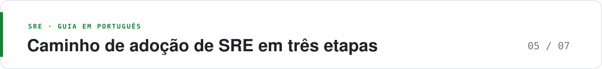

  <picture>
    <source media="(prefers-color-scheme: dark)" srcset="https://raw.githubusercontent.com/adnazare/sre-guide-ptbr/main/assets/banner-05.svg">
    
  </picture>

# Caminho de adoção de SRE em três etapas

*Para quem: líderes, plataforma e equipes que decidem a ordem de adoção · Leitura: cerca de 10 min*

**O essencial**

- São três etapas e cada uma assume a anterior: Foundation, Advanced e AI-assisted.
- Marco é evidência, não kickoff. Sem SLI confiável não há canary nem IA útil.
- A ordem vale para qualquer porte de empresa; o calendário é que muda.
- A IA não espera a etapa 3: o time já usa agentes. Por isso há uma faixa própria para a IA, e ela é revista todo trimestre.

**Foundation** é o que sustenta tudo, **Advanced** é entregar e ensaiar falhas com segurança, **AI-assisted** é dar à IA o que ela pode fazer sozinha. Cada etapa assume a anterior, com uma exceção: a IA que só lê e resume pode entrar cedo, porque não muda produção. A IA que age em produção é que espera pelos fundamentos.

Adotar IA sem SLIs (indicadores de nível de serviço) confiáveis tende a aumentar a verificação manual. O SRE Report 2026, com 418 respondentes, vai nessa direção: toil mediano reportado de 34% e só 13% com muita ou extrema confiança em monitorar a confiabilidade de IA. A pesquisa não prova causa e efeito; a recomendação de ordem é do guia.

As estimativas valem para um produto com uma jornada crítica e um time de plataforma de duas a cinco pessoas. Empresa com dezenas de domínios multiplica o calendário, não a ordem. Os marcos são um exemplo de sequência, não um prazo universal: adapte-os à criticidade, à capacidade e aos requisitos regulatórios da organização. Fontes e critérios estão na [bibliografia](07-referencias.md).

## As três etapas

| Etapa | Foco | Duração típica | Pronto quando |
| --- | --- | --- | --- |
| [1. Foundation](#1-foundation-fundamentos) | SLI, SLO, burn rate, plantão e postmortem em uma jornada | 1º e 2º trimestres | A jornada tem alerta de budget e uma política já aplicada |
| [2. Advanced](#2-advanced-avançado) | Error budget gate, canary, OpenTelemetry, chaos com hipótese | 3º e 4º trimestres | Release não urgente para quando o budget acaba e o rollback foi ensaiado |
| [3. AI-assisted](#3-ai-assisted-com-apoio-de-ia) | IA que age, com evidência, limite e revisão humana. A IA que só lê já entra na [faixa própria](#a-ia-em-faixa-própria-revista-todo-trimestre) | Ciclos de 6 a 8 semanas por caso de uso | A sugestão cita a fonte e o toil de revisão é medido |

### 1. Foundation (fundamentos)

- **Entra:** SLI bom/total nas jornadas que sustentam o negócio, SLO escrito, burn rate para página e ticket, runbook de uma página, plantão com escala, postmortem de SEV-1, Prometheus ou equivalente, probe sintético da jornada, requests e probes no Kubernetes.
- **Ainda não entra:** canary obrigatório, chaos em produção, XLO (objetivo de nível de experiência) ligado a receita, agente com ação em produção.
- **Duração típica:** 1º e 2º trimestres.
- **Pronto quando:** uma jornada tem alerta de budget e uma política que alguém já aplicou.

### 2. Advanced (avançado)

- **Entra:** error budget gate, canary com abort, OpenTelemetry (OTel) no caminho crítico, teto de cardinalidade, retenção em camadas, game day trimestral e depois mensal, golden path (caminho padrão) para serviço novo, capacidade do gargalo com headroom.
- **Ainda não entra:** agente com ação em produção, dezenas de XLOs.
- **Duração típica:** 3º e 4º trimestres.
- **Pronto quando:** release não urgente para quando o budget acaba, o rollback foi ensaiado e houve um exercício de chaos em produção com hipótese.

### 3. AI-assisted (com apoio de IA)

- **Entra:** agente que investiga com acesso de leitura e cita a evidência, rascunho de postmortem revisado, status a partir de template, sugestão de capacidade com teto humano, ação automática só na allowlist (scale dentro do teto, rollback de canary), e avaliação (eval) de LLM se houver modelo em produção.
- **Controles de qualquer agente:** identidade própria com privilégio mínimo e credencial temporária, execução isolada (sandbox), log de cada ação, kill switch e processo testado com o agente desligado.
- **Ainda não entra:** remediação aberta (“conserta o cluster”) e página decidida pelo modelo.
- **Duração típica:** depois do Advanced, em ciclos de 6 a 8 semanas por caso de uso.
- **Pronto quando:** a sugestão cita a query ou o evento, uma pessoa assina o SEV-1, o toil da tarefa-alvo cai e o toil de revisão é medido.

## Exemplo de caminho em 24 meses

Marco significa evidência, não kickoff.

| Mês | Marco | Evidência |
| --- | --- | --- |
| 0–2 | Inventário das jornadas e das páginas atuais | Lista de páginas com coluna “teve ação?” |
| 2–4 | SLI e SLO da jornada principal, burn rate no ar, limiar antigo em ticket | 30 dias de SLI. Página nova documentada |
| 4–6 | Política de budget usada de verdade pelo menos uma vez, ou ensaiada em game day de mesa | Ata da decisão de parar ou de seguir, com o estado do budget |
| 6–9 | Runbooks das páginas que restaram. Escala, sombra e handoff. Postmortem no prazo para SEV-1 | % de SEV-1 com documento em cinco dias úteis |
| 9–12 | OpenTelemetry nos serviços dessa jornada. Collector remove atributo proibido. Um backend de trace | Trace de um 5xx aberto a partir do exemplar |
| 12–15 | Canary com abort no serviço stateless principal. Flag com dono | Um rollback automático registrado |
| 15–18 | Teto de cardinalidade e retenção em camadas. Custo de telemetria visível por serviço | Série ativa estável após um release |
| 18–21 | Game day em produção, hipótese de perda de zona ou de dependência, remediação de IA desligada | Relato com o que quebrou na hipótese |
| 21–24 | Golden path para serviço novo com SLO obrigatório. Primeira ação automática na allowlist, se o Advanced estiver de pé. A faixa da IA segue em paralelo | Serviço novo chega ao primeiro deploy já com burn rate. Ação do agente comparada com o que a pessoa faria |

Se no mês 12 o SLI ainda não reflete a experiência real, não puxe o canary “para cumprir o plano”. Canary sem SLI por versão só promove mais rápido.

## A IA em faixa própria, revista todo trimestre

A IA muda mais rápido que qualquer outro tema do guia: produtos de agente de SRE de fornecedores foram lançados em 2025 e 2026, e agentes de código passaram a gerar parte da mudança que chega à produção. Por isso, esta faixa não segue o calendário de 24 meses. Ela roda ao lado e ganha uma revisão a cada três meses, com a pergunta: o que mudou e o que isso muda nos nossos controles?

| Quando | Marco | Evidência |
| --- | --- | --- |
| Desde o início | Inventário de onde a IA já é usada, inclusive automações criadas fora da engenharia, e regra do que pode ir para um modelo (dado pessoal, segredo, log) | Lista com dono e tipo de dado de cada uso |
| Foundation | Assistente só de leitura: resumo de incidente, busca em runbook e postmortem, sempre com a fonte | Resposta que cita o link do evento ou da query |
| Advanced | Identidade e sandbox para agentes de código e de operação; mudanças geradas por agente passam pelo mesmo canary e budget gate | Agente sem credencial fixa e com ação registrada |
| Advanced | Se há modelo em produção: gateway com limites de custo e failover, traces e avaliação versionada, e fluxos de agente que retomam depois de falha | SLO e orçamento do gateway; um fluxo retomado depois de falha induzida |
| AI-assisted | Ação automática na allowlist, com kill switch, testada com o agente desligado | Um game day com o agente desligado |

A cada revisão trimestral, confira três coisas: se uma ferramenta nova do seu fornecedor entrou sem passar pela allowlist, se o custo de modelo ou de GPU fugiu do previsto, e se alguma automação virou processo importante sem dono. O que não muda: SLI confiável, política de budget e postmortem. É por isso que a ordem dos etapas se mantém, mesmo com a IA mudando.

## Lições de implantação

O que mais atrasa a adoção não é ferramenta. É gente, hábito e decisão. Estas práticas costumam funcionar:

- **Primeiro a facilidade, depois a cobrança.** “Você constrói, você opera” só funciona se a plataforma torna o caminho seguro o mais fácil: catálogo de serviços, template de pipeline e alerta pronto. Cobrar SLO sem isso gera planilha, não confiabilidade.
- **Meça a linha de base antes de prometer melhoria.** Golden signals e métricas DORA de hoje são o que dá sentido ao resultado de daqui a seis meses.
- **Comece com um time que sente a dor.** Piloto com voluntário ensina mais que mandato para todos, e o caso concreto convence os outros.
- **Ensine pelo plantão.** Acompanhar um plantão como observador, postmortem em grupo e runbook escrito junto formam o time melhor que um curso.
- **Alguém de produto decide o budget.** Sem essa pessoa na política, o SLO vira painel bonito que ninguém usa para decidir.
- **Em ambiente regulado, a auditoria entra no desenho.** Colocar depois custa mais do que parece.

## Recomendação por cenário

### Startup

Pouca gente, um produto, mudança diária.

- Foundation inteira num serviço, não um programa.
- Stack: OTel SDK, Prometheus, Grafana, Alertmanager, plantão gerenciado, status manual.
- SLO de 99,9% já é ambicioso. 99,5% honesto vale mais que 99,99% de fachada.
- Follow-the-sun não existe. Combine a janela de plantão com o que o negócio aceita de espera.
- Adie agente com ação em produção. O fundador lendo o burn rate aprende mais. Já assistente de leitura e rascunho vale desde o dia 1, desde que não receba dado pessoal nem segredo.

### Scale-up

Vários times, incidentes começam a se repetir, a conta de cloud aparece.

- Advanced no caminho crítico. Foundation nos serviços novos, via template, para não refazer a consultoria em cada squad.
- Canary e error budget gate pagam o investimento aqui.
- Uma ferramenta de incidente com papéis e timeline. Chat sozinho perde o fio.
- Cardinalidade vira tema assim que o segundo produto instrumenta `tenant_id` em métrica.
- Assistente de resumo só depois de existir uma timeline. Sem timeline, o modelo inventa a ordem dos fatos.
- Com agentes de código, o volume de mudança sobe. Canary e error budget gate deixam de ser opcionais antes do previsto.

### Enterprise

Muitos domínios, contratos, auditoria, ferramentas já compradas.

- Não troque de vendor no mês 1. Coloque OTel na frente do que já está pago, para a próxima renovação ter saída.
- Política de budget por domínio, com um fórum único de exceção. Sem isso, cada VP redefine o SLO.
- A plataforma publica o caminho padrão. O SRE de produto fica nos domínios que o caminho não cobre e na engenharia do caminho.
- Opsgenie, se ainda estiver no meio, tem data: suporte até 5 de abril de 2027. A migração para Jira Service Management entra no caminho, não como surpresa. Detalhes e fonte em [Ferramentas](06-ferramentas-2026.md#gestão-de-incidente-e-on-call).
- Faça o inventário de uso de IA já no primeiro trimestre: o que existe fora da engenharia tende a aparecer só quando quebra. Se houver modelo em produção, um gateway único concentra custo, acesso e failover.
- AI-assisted entra por rascunho e por busca, com retenção e residência de dado aprovadas. Ação automática fica na allowlist que o change board já entende: scale dentro do teto e rollback do canary.

### Indústria regulada

Requisito de trilha de auditoria, mudança aprovada, dado pessoal.

- O mesmo desenho técnico, com três acréscimos: audit log de quem mudou alerta e de quem abriu trace, atributo sensível removido no collector e chaos em produção só com mudança aprovada e abort.
- Postmortem pode conter dado explorável. Classifique o documento.
- “O modelo sugeriu” não é evidência de controle. Guarde a query, a versão do prompt e o nome de quem aceitou.
- SLO do plano de controle de acesso separado do SLO do plano de dados.

### Cloud-native

Kubernetes, vários serviços, deploy contínuo.

- Primitivos no admission: request, probe correta, PDB (PodDisruptionBudget), spread de zona.
- Burn rate por serviço no golden path.
- Progressive delivery como padrão do caminho; serviço fora do caminho é exceção com prazo.
- Game day de perda de zona é o experimento que o cluster pede primeiro.
- Platform SRE é o modelo de time: poucos engenheiros construindo o caminho, não um SRE sentado em cada squad para aprovar YAML.

## O que não entra nos primeiros 24 meses

- Substituir o plantão por agente.
- Agente com credencial fixa e acesso amplo, sem sandbox nem log de ação.
- Reescrever todos os serviços para um service mesh antes de ter um SLI.
- Sete ferramentas de observabilidade “para comparar”.
- Meta de disponibilidade única para a empresa inteira.
- Chaos contínuo em todo namespace no primeiro ano.

## Sinais para aprofundar uma área

Aprofunde uma categoria, com impacto explícito, se acontecer um destes sinais:

| Sinal | Aprofundar | Impacto |
| --- | --- | --- |
| A fatura de log ou de métricas customizadas domina a plataforma | Governança de telemetria e a escolha entre SigNoz, Mimir ou SaaS | Custo operacional direto |
| SEV-1 sempre nasce em release | Progressive delivery e expand-contract | Confiabilidade e taxa de falha de mudanças |
| O plantão pede demissão | Filosofia de paging e escala, antes de ferramenta nova | Retenção e MTTR (tempo médio de recuperação) noturno |
| Mais da metade do tráfego depende de um terceiro | SLO do terceiro, timeout, sintético, chaos de dependência | Risco de disponibilidade fora do seu deploy |
| Modelo em produção sem eval | Observabilidade de LLM | Qualidade e custo, separados do 5xx |
| Automação com IA surgindo fora da engenharia | Inventário e caminho seguro até a produção | Risco de processo importante sem dono nem alerta |
| Custo de modelo ou de GPU imprevisível | Gateway de modelos e FinOps | Custo operacional e previsibilidade |
| Fluxo de agente que recomeça do zero depois de falhar | Execução durável | Confiabilidade e custo de reprocessamento |

Sem um desses sinais, o desenho inicial do guia já cobre o necessário. Expandir sem eles só aumenta o número de páginas de alerta.

---

[← Anterior: Anti-padrões](04-antipadroes-e-licoes.md) · [Índice do guia](../README.md#mapa-do-guia) · [Próxima: Ferramentas →](06-ferramentas-2026.md)
