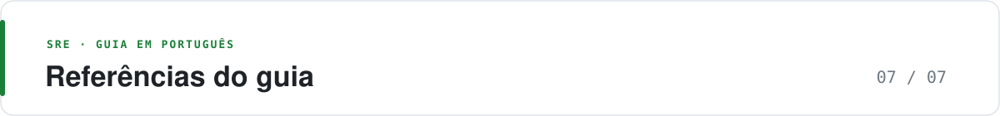

  <picture>
    <source media="(prefers-color-scheme: dark)" srcset="https://raw.githubusercontent.com/adnazare/sre-guide-ptbr/main/assets/banner-07.svg">
    
  </picture>

# Referências do guia

*Para quem: quem quer conferir a origem de uma afirmação · Consulta*

Esta página reúne só as fontes que sustentam o que está nas páginas. Não é uma lista exaustiva, e a ideia do guia é justamente que você não precise ler tudo isto. Para o que muda com frequência (suporte, preço, funcionalidades de produto), confirme na documentação oficial de cada ferramenta citada em [Ferramentas](06-ferramentas-2026.md).

Pesquisa de mercado vale para quem respondeu. Status de maturidade, esforço e custo relativo são avaliação editorial do guia, não benchmark. Última revisão: 3 de novembro de 2026.

## Pesquisa e IA

- Catchpoint / LogicMonitor, [2026 SRE Report](https://www.logicmonitor.com/resources/sre-report-2026): pesquisa com 418 respostas, aberta em julho e agosto de 2025.
- Catchpoint, [AI optimism and the economics of effort](https://www.catchpoint.com/blog/sre-report-2026-ai-optimism-and-the-economics-of-effort): análise de toil, IA e confiança em observar IA.
- DORA, [2025 DORA Report](https://dora.dev/research/2025/dora-report/): IA e desenvolvimento de software; contexto, não benchmark de SRE.
- NIST, [AI Risk Management Framework](https://www.nist.gov/itl/ai-risk-management-framework): organização de riscos de IA.
- OpenTelemetry, [GenAI Semantic Conventions](https://github.com/open-telemetry/semantic-conventions-genai): ainda em evolução; confira o status antes de adotar.

## Fundamentos de SRE

- Google, [Site Reliability Engineering](https://sre.google/sre-book/table-of-contents/) e [The Site Reliability Workbook](https://sre.google/workbook/table-of-contents/).
- Google Workbook, [Implementing SLOs](https://sre.google/workbook/implementing-slos/) e [Alerting on SLOs](https://sre.google/workbook/alerting-on-slos/): base dos exemplos de SLO e burn rate.
- Google, [Incident Management Guide](https://sre.google/resources/practices-and-processes/incident-management-guide/) e [Postmortem Culture](https://sre.google/workbook/postmortem-culture/).
- AWS, [Well-Architected: pilar de confiabilidade](https://docs.aws.amazon.com/wellarchitected/latest/reliability-pillar/welcome.html) e Microsoft, [Azure Well-Architected: confiabilidade](https://learn.microsoft.com/en-us/azure/well-architected/reliability/).
- Google, [Being On-Call](https://sre.google/sre-book/being-on-call/): origem do teto de dois incidentes por turno de 12 horas.
- Brendan Gregg, [USE Method](https://www.brendangregg.com/usemethod.html).

## Telemetria, entrega e resiliência

- [OpenTelemetry](https://opentelemetry.io/docs/), [Prometheus](https://prometheus.io/docs/introduction/overview/) e [Kubernetes](https://kubernetes.io/docs/).
- [Argo Rollouts](https://argo-rollouts.readthedocs.io/en/stable/): exemplo de controller de canary.
- [Principles of Chaos Engineering](https://principlesofchaos.org/).

## Ferramentas e lançamentos de 2025 e 2026

- [Datadog Bits AI SRE](https://www.datadoghq.com/about/latest-news/press-releases/datadog-launches-bits-ai-sre-agent-to-resolve-incidents-faster/), [Azure SRE Agent](https://techcommunity.microsoft.com/blog/appsonazureblog/announcing-general-availability-for-the-azure-sre-agent/4500682), [AWS DevOps Agent](https://aws.amazon.com/blogs/mt/announcing-general-availability-of-aws-devops-agent/), [PagerDuty Paige](https://www.businesswire.com/news/home/20261103256294/en/PagerDuty-Unveils-Paige-an-SRE-Agent-and-the-PD-Reliability-Platform---Establishes-PD-Labs-to-Power-Open-AI-Innovation-in-Reliability-Engineering) e [Grafana Assistant](https://www.businesswire.com/news/home/20261020082945/en/Grafana-Labs-Charts-the-Path-to-Agentic-Operations-with-Watchers-Pages-and-Agent-Observability-at-ObservabilityCON-2026): anúncios dos fornecedores.
- Edge Delta, [Best AI SRE Tools in 2026](https://edgedelta.com/ai-sre-tools): comparação de terceiros, usada para incident.io e Dynatrace.
- CNCF, [Landscape: status dos projetos](https://landscape.cncf.io/docs/projects.csv): maturidade de K8sGPT, HolmesGPT, kagent, Kyverno, Karmada, Crossplane, Keptn e outros.
- Atlassian, [Opsgenie: fim de venda e de suporte](https://www.atlassian.com/licensing/opsgenie).

---

[← Anterior: Ferramentas](06-ferramentas-2026.md) · [Índice do guia](../README.md#mapa-do-guia)
